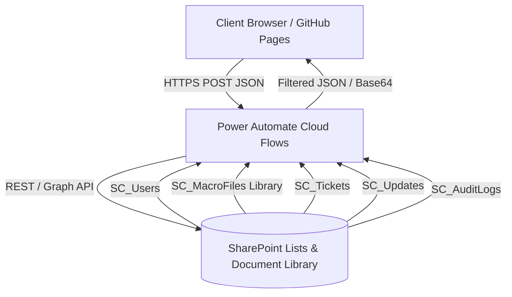

# 🌐 Danfoss SC Supply Chain Tool Hub

> **Centralized enterprise platform for Excel macro files, robotic process automation bots, support ticketing, and operational announcements.**

Built for Danfoss Supply Chain operations. Integrates **GitHub Pages** (responsive frontend) with **SharePoint Online** and **Microsoft Power Automate** (cloud orchestration backend).

---

## 🏛️ Architecture Overview



- **Frontend**: Zero-build vanilla HTML5, CSS3 design system (Danfoss corporate palette, dark/light themes, glassmorphism, micro-animations), and modern JavaScript.
- **Backend & Database**: SharePoint Online lists (`SC_Users`, `SC_Tickets`, `SC_Updates`, `SC_AuditLogs`) and SharePoint Document Library (`MacroUploads`).
- **API Middleware**: 6 Microsoft Power Automate HTTP-triggered cloud flows with enterprise role-based authorization.

---

## 🚀 Key Features

| Module | Features & Capabilities |
| :--- | :--- |
| **🏠 Home Dashboard** | Quick-action tiles, operational status banner, unread announcement alerts. |
| **📊 Macro Files** | Browse, search, filter by extension (`.xlsm`, `.xlsb`, `.xlsx`, `.bas`), and securely download verified operational macro tools. |
| **🤖 Automation Bots** | Production bot status monitor, scheduled execution tracking, and bot request intake. |
| **🎫 Raise a Ticket** | Submit operational issues with severity levels, category tagging, and track administrator resolution notes. |
| **📣 Announcements** | Feed of system updates, macro version releases, and maintenance notices with admin broadcasting. |
| **🛡️ Admin Panel** | Drag-and-drop macro upload to SharePoint, user role governance, ticket status updater, and full audit trail. |
| **⚙️ Settings** | User profile customization, credential management, and one-click Dark/Light mode toggle. |

---

## ⚙️ Configuration (`assets/js/config.js`)

All endpoints are configured centrally in `assets/js/config.js`:

```javascript
window.CFG = {
  // Power Automate HTTP POST Endpoints
  FLOW_AUTH_URL:    "https://.../workflows/.../triggers/manual/paths/invoke?api-version=1",
  FLOW_FILES_URL:   "https://.../workflows/.../triggers/manual/paths/invoke?api-version=1",
  FLOW_TICKETS_URL: "https://.../workflows/.../triggers/manual/paths/invoke?api-version=1",
  FLOW_UPDATES_URL: "https://.../workflows/.../triggers/manual/paths/invoke?api-version=1",
  FLOW_ADMIN_URL:   "https://.../workflows/.../triggers/manual/paths/invoke?api-version=1",
  FLOW_LOGS_URL:    "https://.../workflows/.../triggers/manual/paths/invoke?api-version=1",

  // SharePoint Online Configuration
  SHAREPOINT_SITE_URL:   "https://danfoss.sharepoint.com/sites/SCAutomation",
  SHAREPOINT_FOLDER_URL: "https://danfoss.sharepoint.com/.../MacroUploads",

  // App Settings
  ALLOWED_EMAIL_DOMAIN: "danfoss.com", // Restricts registrations to enterprise domain
  POLL_SECONDS: 120,                   // Background refresh interval
  SESSION_HOURS: 8,                    // Session duration
  APP_VERSION: "2.0.0"
};
```

---

## 🛡️ Security & Hardening Measures

- **Zero Plaintext Credentials in Storage**: Passwords are never persisted in browser `localStorage`.
- **XSS & Injection Protection**: Strict HTML escaping on all dynamic data and delegated DOM event listeners (no string-interpolated inline execution).
- **Safe SharePoint URL Resolver**: Automatically maps server-relative URLs (`/sites/...`) to authenticated SharePoint tenant domains.
- **Client & Flow Role Guards**: Strict client-side view restrictions combined with server-side role validation in Power Automate flows before executing privileged actions.

---

## 📦 Deployment to GitHub Pages

1. **Verify Files**: Ensure all files are committed to the repository.
2. **Push to GitHub**:
   ```bash
   git push origin main
   ```
3. **Enable GitHub Pages**:
   - Go to your repository on GitHub $\rightarrow$ **Settings** $\rightarrow$ **Pages**.
   - Under **Build and deployment**, select **Deploy from a branch**.
   - Set Branch to `main` (or `master`) and folder to `/ (root)`.
   - Click **Save**. Within 1–2 minutes your site is live at:
     `https://<your-username>.github.io/SC-Tool-Hub/`

---

*Danfoss Supply Chain Digitalization — Engineering Tomorrow*
